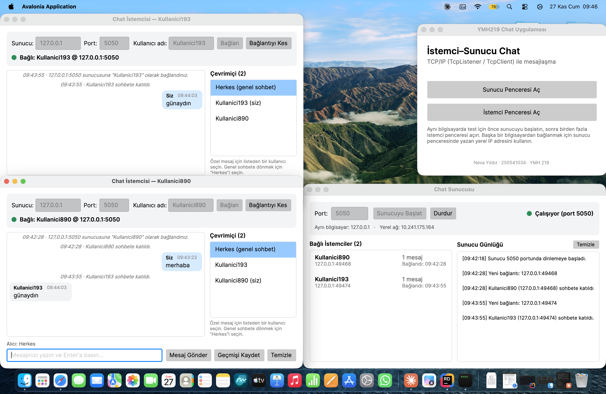
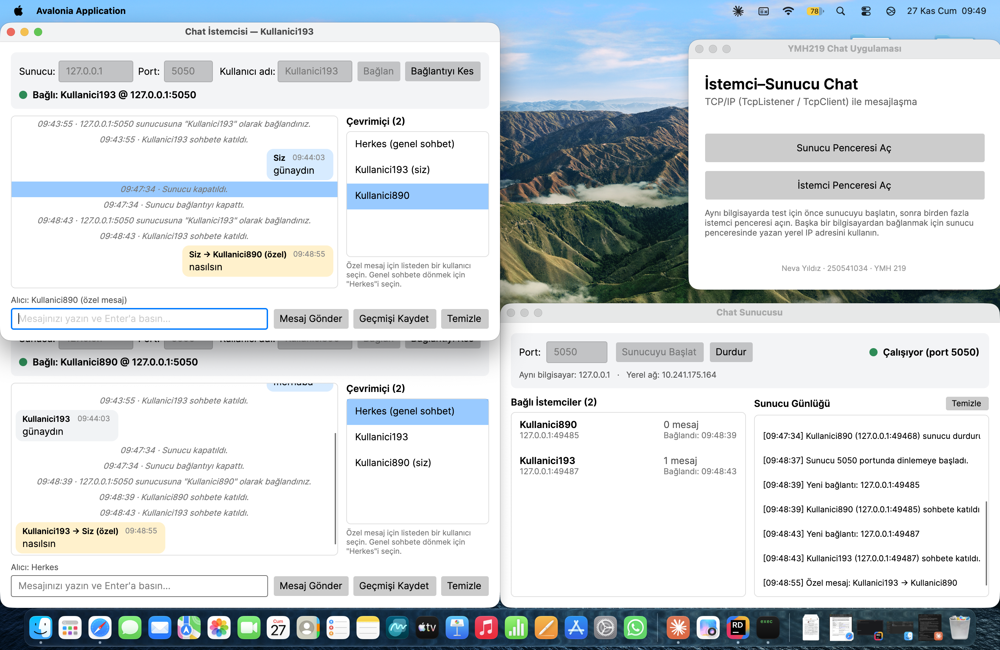
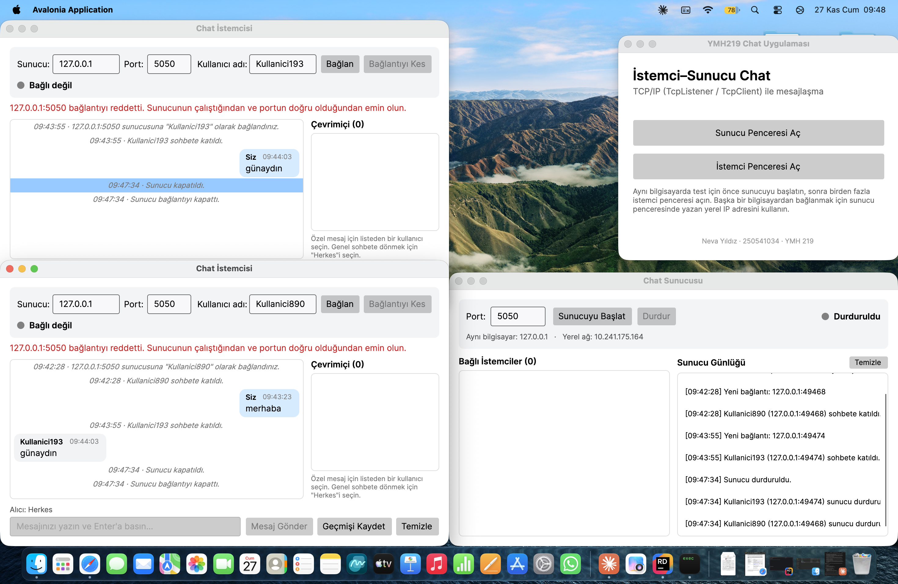
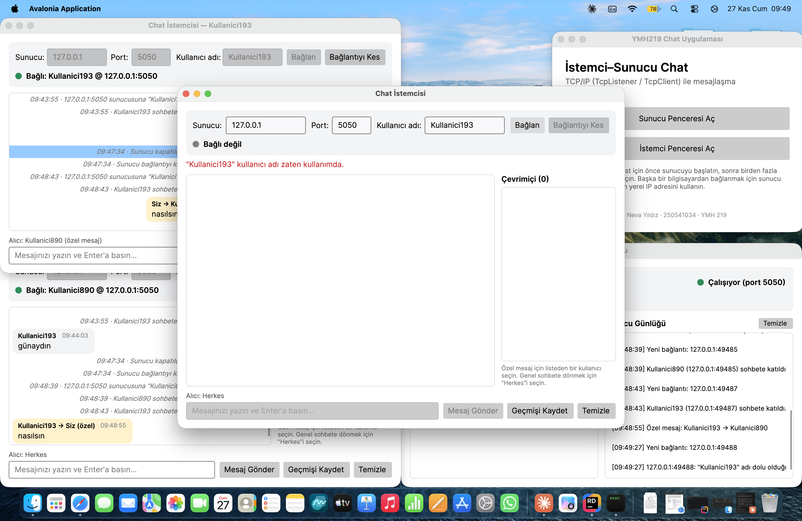

# YMH219-ChatApp — İstemci-Sunucu Chat Uygulaması

TCP/IP üzerinden çalışan, bir sunucu ve birden fazla istemciden oluşan masaüstü sohbet uygulaması.
İstemciler kullanıcı adıyla bağlanır, ortak odada mesajlaşır, isterlerse birbirlerine özel mesaj gönderir.
Sunucu bağlı istemcileri ve olay günlüğünü canlı olarak listeler.

> **Not (Avalonia):** Föyde Windows Forms istenmektedir. Geliştirme macOS (Apple Silicon) üzerinde yapıldığı için
> hocanın onayıyla Windows Forms yerine aynı olay tabanlı modeli kullanan, çapraz platform **Avalonia UI** tercih edildi.
> `Button.Click`, `KeyDown`, `ListBox` gibi kavramlar Windows Forms ile birebir karşılık gelir; uygulama Windows,
> macOS ve Linux'ta çalışır.

## Kullanılan Teknolojiler / NuGet Paketleri

| Teknoloji | Açıklama |
|---|---|
| .NET 8 / C# 12 | Uygulama çatısı |
| Avalonia UI 11.2.3 | Arayüz (`Avalonia`, `Avalonia.Desktop`, `Avalonia.Themes.Fluent`, `Avalonia.Fonts.Inter`) |
| `System.Net.Sockets` | `TcpListener` (sunucu), `TcpClient` (istemci), `NetworkStream` |
| `StreamReader` / `StreamWriter` | Satır tabanlı okuma/yazma |
| `System.Text.Json` | Paketlerin tek satır JSON olarak serileştirilmesi |
| `async/await`, `CancellationToken` | Arayüzü dondurmadan ağ işlemleri, zaman aşımı ve durdurma |

## Proje Yapısı

```
YMH219-ChatApp.sln
src/
├── ChatApp.Core/              # Arayüzden bağımsız ağ ve sohbet mantığı
│   ├── Protocol/
│   │   ├── PacketType.cs      # Join, Accepted, Rejected, Chat, Private, UserList, System, Leave
│   │   ├── ChatPacket.cs      # Ağ paketi + fabrika metotları
│   │   └── PacketSerializer.cs# Tek satır JSON <-> paket
│   ├── Server/
│   │   ├── ChatServer.cs      # TcpListener, kabul döngüsü, yayın, özel mesaj yönlendirme
│   │   └── ClientConnection.cs# Sunucu tarafında tek istemci (soket, okuyucu/yazıcı, bilgiler)
│   ├── Client/
│   │   ├── ChatClient.cs      # TcpClient, bağlanma/zaman aşımı, arka planda okuma
│   │   └── ChatException.cs   # Kullanıcıya gösterilebilir hata
│   ├── Models/
│   │   ├── ChatMessage.cs     # Ekranda gösterilen mesaj satırı
│   │   └── ChatHistory.cs     # Geçmişi .txt'ye yazma
│   └── NetworkHelper.cs       # Yerel IP adresleri, port doğrulama
└── ChatApp/                   # Avalonia arayüzü
    ├── Views/
    │   ├── LauncherWindow     # Sunucu / istemci penceresi açma
    │   ├── ServerWindow       # Sunucu paneli
    │   └── ClientWindow       # Sohbet penceresi
    └── Models/                # ClientRow, UserEntry (arayüz satır modelleri)
```

### Haberleşme Protokolü

Her paket tek satırlık bir JSON nesnesidir ve `\n` ile biter; böylece `StreamReader.ReadLineAsync()` ile paketler
kolayca ayrılır. Örnek:

```json
{"type":"Chat","from":"Neva","text":"Merhaba!","timestamp":"2026-11-27T10:15:03"}
```

1. İstemci bağlanınca ilk paket olarak `Join` (kullanıcı adı) gönderir.
2. Sunucu adı kontrol eder: boşsa `Accepted`, kullanımdaysa `Rejected` döner.
3. Sunucu herkese `System` ("... katıldı") ve güncel `UserList` paketini yayınlar.
4. `Chat` paketleri herkese, `Private` paketleri yalnızca alıcıya ve gönderene iletilir. Zaman damgasını sunucu yazar.
5. İstemci ayrılırken `Leave` gönderir; bağlantı beklenmedik koparsa sunucu bunu okuma hatasından anlar.

## Kurulum ve Çalıştırma

Gereksinim: [.NET 8 SDK](https://dotnet.microsoft.com/download/dotnet/8.0)

```bash
git clone https://github.com/nevayildiz/YMH219-ChatApp.git
cd YMH219-ChatApp
dotnet run --project src/ChatApp
```

Rider / Visual Studio ile: `YMH219-ChatApp.sln` dosyasını açıp **ChatApp** projesini çalıştırın.

**Aynı bilgisayarda test:**
1. Başlatıcıdan **Sunucu Penceresi Aç** → port (varsayılan 5000) → **Sunucuyu Başlat**.
2. Başlatıcıdan iki veya daha fazla **İstemci Penceresi Aç**.
3. Her istemcide sunucu `127.0.0.1`, port `5000`, farklı bir kullanıcı adı yazıp **Bağlan**.

**Yerel ağda test:** Sunucu penceresinde yazan "Yerel ağ" IP adresini (ör. `192.168.1.34`) diğer bilgisayardaki
istemcide sunucu adresi olarak girin. macOS ilk başlatmada gelen bağlantılara izin isteyebilir; **İzin Ver** seçilmelidir.

## Temel Özellikler

**Asgari gereksinimler**
- Sunucu (`TcpListener`) ve birden fazla istemci (`TcpClient`); aynı bilgisayarda veya yerel ağda çalışır.
- İstemci kullanıcı adı ile bağlanır; aynı ad ikinci kez kullanılamaz.
- Gönderilen ve alınan mesajlar saat bilgisiyle (`HH:mm:ss`) gösterilir; kendi mesajlarınız sağda, diğerleri solda.
- **Bağlan**, **Mesaj Gönder** (veya Enter) ve **Bağlantıyı Kes** işlevleri.
- Bağlantı hataları (sunucu kapalı, yanlış adres/port, zaman aşımı, bağlantı kopması, dolu port) uygulamayı
  kapatmadan pencerede kırmızı mesajla bildirilir.
- Sunucu penceresinde bağlı istemcilerin kullanıcı adı, IP:port, bağlanma saati ve mesaj sayısı listelenir.
- Renkli durum göstergesi: gri (bağlı değil / durduruldu), turuncu (bağlanıyor), yeşil (bağlı / çalışıyor).

**İsteğe bağlı geliştirmeler**
- ✅ Birden fazla istemcinin aynı odaya katılması (katıldı/ayrıldı bildirimleri, çevrimiçi listesi)
- ✅ Özel mesaj: çevrimiçi listesinden kullanıcı seçilince mesaj yalnızca ona gider (sarı balon)
- ✅ Mesaj geçmişinin `.txt` dosyasına kaydedilmesi (**Geçmişi Kaydet**)

### Nesne Tabanlı Tasarım

- Ağ mantığı (`ChatApp.Core`) arayüzden tamamen ayrıdır; `ChatServer` ve `ChatClient` hiçbir Avalonia türü kullanmaz
  ve olaylar (`event Action<...>`) ile arayüze haber verir. Arayüz bu olayları `Dispatcher.UIThread.Post` ile
  UI iş parçacığına aktarır.
- `ClientConnection` her istemcinin soketini, okuyucu/yazıcısını ve bilgilerini kapsüller; `SemaphoreSlim` ile
  aynı istemciye eşzamanlı yazmalar sıraya alınır.
- Tek bir istemciye gönderimin başarısız olması diğerlerini etkilemez (`SafeSendAsync`).
- `ChatException`, teknik hataları (`SocketException`, `IOException`) kullanıcıya anlaşılır Türkçe mesajlara çevirir.

## Ekran Görüntüleri

**Genel sohbet** — sunucu çalışıyor, iki istemci bağlı; sunucu panelinde istemcilerin IP:port, bağlanma saati ve mesaj sayısı görünüyor.



**Özel mesaj** — çevrimiçi listesinden kullanıcı seçilince mesaj yalnızca ona gider (sarı balon), sunucu günlüğüne de işlenir.



**Bağlantı hatası** — sunucu durdurulunca istemciler bilgilendirilir; kapalı sunucuya bağlanma denemesi uygulamayı kapatmadan kırmızı mesajla bildirilir.



**Kullanıcı adı kullanımda** — aynı adla ikinci bağlantı sunucu tarafından reddedilir.



## Bilinen Sınırlamalar / Geliştirme Notları

- Tek bir sohbet odası vardır; birden fazla oda desteklenmez.
- Bağlantı şifrelenmez (düz TCP); yalnızca ders kapsamında yerel ağda kullanım içindir.
- Kimlik doğrulama yoktur; kullanıcı adı yalnızca o oturum için benzersizdir.
- Sunucu mesaj geçmişini saklamaz; sonradan katılan kullanıcı önceki mesajları göremez.
- Kopan bağlantı otomatik olarak yeniden kurulmaz; kullanıcı tekrar **Bağlan**'a basmalıdır.

---

**Öğrenci:** Neva Yıldız · **Numara:** 250541034 · Nesne Tabanlı Programlama (YMH 219)
